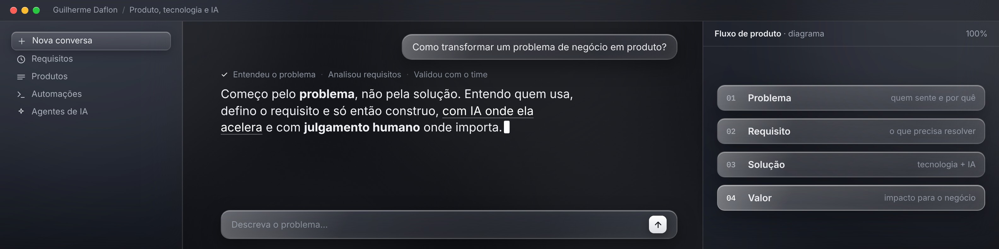

## Sobre mim

Sou Analista de Produto, atuando com sistemas de crédito imobiliário: levantamento e análise de requisitos, homologação e implantação. Estudo Sistemas de Informação na Unilasalle-RJ.

Gosto de entender o problema antes de pensar na solução. Uso IA no dia a dia para acelerar análise, testes e automações, sempre com validação humana nas decisões que importam.

## Projetos

- **Agenda com IA para estúdio de pilates.** PWA em Next.js + Supabase, em produção, com um agente que marca aulas a partir de mensagens em linguagem natural.
- **Automação de processos com IA.** Rotinas com backup, auditoria contra a fonte oficial e bloqueio automático quando algo dá errado.

Os projetos vão chegando aqui, um de cada vez.

## Ferramentas

`Next.js` `Supabase` `Python` `SQL` `PostgreSQL` `Oracle` `Java` `Streamlit` `SQLAlchemy` `Git` `Docker` `Claude Code`

## Contato

[LinkedIn](https://www.linkedin.com/in/gdaflonpro)
